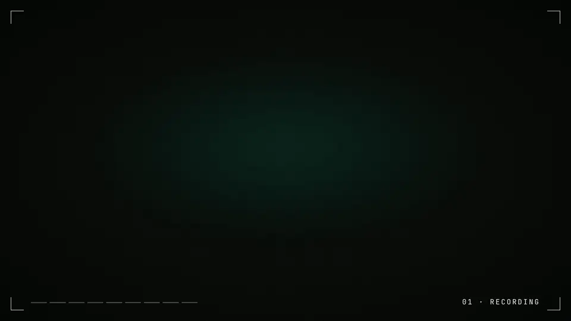

<p align="center">
  <picture>
    <source media="(prefers-color-scheme: dark)" srcset="brand/readme/hero-dark.svg">
    <source media="(prefers-color-scheme: light)" srcset="brand/readme/hero-light.svg">
    
  </picture>
</p>

<h3 align="center">Stop transcribing. Start playing.</h3>

<p align="center">
  AI writes the score and tab from any guitar recording, so your time goes to playing, not to rewinding.<br>100% free, 100% open source, 100% on your Mac or PC.
</p>

<p align="center">
  <a href="https://github.com/AdamPomposelli/tabscribe/releases/latest"></a>
  
  
  
  
  <a href="LICENSE"></a>
  <a href="https://github.com/AdamPomposelli/tabscribe/stargazers"></a>
</p>

<p align="center">
  <a href="https://github.com/AdamPomposelli/tabscribe/releases/latest/download/Tabscribe.dmg">
    
  </a>
  <a href="https://github.com/AdamPomposelli/tabscribe/releases/latest/download/Tabscribe-Setup.exe">
    
  </a>
  <br>
  <sub>No account · No subscription · <a href="#quick-start">Ready in about 5 minutes</a></sub>
</p>

<p align="center">
  <a href="#quick-start">Quick start</a> |
  <a href="#everything-it-does">Features</a> |
  <a href="#privacy">Privacy</a> |
  <a href="#make-it-yours">Make it yours</a> |
  <a href="#contributing">Contributing</a>
</p>

<!-- Made with HyperFrames; source and re-render steps in brand/demo/. -->
<p align="center">
  
</p>

## ❤️ Why Tabscribe

Working out a song by ear means hours of rewinding the same four seconds. Let the AI do that part.

<table>
  <tr>
    <td align="center" width="72"><h3>⏱️</h3></td>
    <td><b>Hours back, every song.</b><br>Drop a recording, get the score and the tab in about a minute: notes, rhythm, chords, key, tempo and a fingering you can actually play.</td>
  </tr>
  <tr>
    <td align="center"><h3>🔒</h3></td>
    <td><b>Your music stays yours.</b><br>Every model runs on your computer. Your recordings are never uploaded, and there is no Tabscribe server to send them to.</td>
  </tr>
  <tr>
    <td align="center"><h3>💸</h3></td>
    <td><b>Free. Really.</b><br>No subscription, no trial minutes, no account. Transcribe as many songs as you like, as long as you like.</td>
  </tr>
</table>

> [!NOTE]
> **Built by a guitarist who was tired of rewinding.** Tabscribe was tuned song after song against hand-checked transcriptions, including live takes that drift in tempo. If a tab comes out wrong, [tell us](https://github.com/AdamPomposelli/tabscribe/issues/new).

<a id="quick-start"></a>

## ⏱️ Quick start

From download to your first tab in **about 5 minutes**.

| | Step | ⏱ |
|:-:|---|:-:|
| **1** | ⬇️ **Mac:** **[download Tabscribe.dmg](https://github.com/AdamPomposelli/tabscribe/releases/latest/download/Tabscribe.dmg)**, open it, and drag Tabscribe onto Applications.<br>**Windows:** **[download Tabscribe-Setup.exe](https://github.com/AdamPomposelli/tabscribe/releases/latest/download/Tabscribe-Setup.exe)** and run it. | 20 s |
| **2** | 🔓 **Open Tabscribe.** macOS blocks the first launch: right-click the app and choose **Open**, or go to *System Settings → Privacy & Security* and click **Open Anyway**. On Windows, SmartScreen may say it protected your PC: click *More info* → **Run anyway**. | 20 s |
| **3** | 📦 **Install the engine.** The first launch shows exactly what it needs (about 1.5 GB to download, 3 GB on disk), then downloads it with progress bars and checks every file. | 2–4 min |
| **4** | 🎸 **Drop a recording.** Trim it, say whether the guitar plays alone or with a band, and press *Start transcription*. | 20 s |
| **5** | ✨ **Play.** Score, tab and chord boxes, synced to your recording. | <b>~1&nbsp;min&nbsp;⚡</b> |

> [!IMPORTANT]
> Step 2 is there because Tabscribe isn't notarised by Apple or code-signed for Windows yet. You do it once.
> On Windows the AI runs on the CPU: a transcription takes a few minutes instead of about one.

> [!TIP]
> After the first launch, Tabscribe works **fully offline**. *Settings → Components* lets you check, repair, add or remove parts later, like the lighter Demucs isolation or the optional MuScriptor model.

## 🎼 From recording to tab

Every project goes through the same steps, all on your Mac.

| | Step | What happens |
|:-:|---|---|
| ✂️ | **Trim** | Keep only the part you want to learn. |
| 🎚️ | **Isolate** | With vocals or a band, the guitar is separated first (BS-RoFormer). On band recordings this lifts note accuracy from 0.71 to 0.84. |
| 🥁 | **Beats** | Beats and downbeats are tracked, even when the tempo drifts in a live take. |
| 🎵 | **Notes** | Up to seven transcription models vote on every note. |
| 🎼 | **Chords & key** | Chord names, key and time signature, spelled the way a guitarist reads them. |
| 🖐️ | **Fingering** | A fingering model picks positions a hand can actually play. |

<a id="everything-it-does"></a>

## ✨ Everything it does

<table>
  <tr>
    <td width="50%" valign="top">🎸 <b>Score and tab, together</b><br>Standard notation and tablature, with chord names and chord boxes above every change, the key, the tempo, and bass and melody as two voices.</td>
    <td width="50%" valign="top">🎚️ <b>The guitar, isolated by AI</b><br>Vocals, drums and band removed before transcribing, so the notes come from the guitar and nothing else.</td>
  </tr>
  <tr>
    <td valign="top">🔁 <b>Synced to the recording</b><br>Switch between the transcription and the original recording without stopping. The cursor follows both.</td>
    <td valign="top">🥁 <b>Follows live playing</b><br>No metronome needed: the score follows the beat of the recording, even when it speeds up or slows down.</td>
  </tr>
  <tr>
    <td valign="top">🧩 <b>The easiest capo, found for you</b><br>Tabscribe suggests the capo position with the simplest shapes. Change capo, transpose or tuning (Drop D, half step down, Open G, DADGAD) in one click.</td>
    <td valign="top">🖐️ <b>A fingering you can play</b><br>One note per string, open strings when they help, no impossible stretches.</td>
  </tr>
  <tr>
    <td valign="top">🎯 <b>Pick your level</b><br>Original, Intermediate or Beginner: the same song, simplified when you need it.</td>
    <td valign="top">🎹 <b>Falling-notes piano roll</b><br>See every note coming, and scroll over it to scrub through the song.</td>
  </tr>
  <tr>
    <td valign="top">🔊 <b>Real guitar sounds</b><br>Playback with sampled steel-string or nylon guitars. Your choice is remembered.</td>
    <td valign="top">🐢 <b>Slow it down</b><br>Speed control, metronome and volume, on the transcription or on the original.</td>
  </tr>
  <tr>
    <td valign="top">📤 <b>Export everywhere</b><br>Guitar Pro (.gp5) for MuseScore, TuxGuitar and Guitar Pro, MIDI (quantised or as played), and PDF. <a href="export-examples/">See real exports</a>.</td>
    <td valign="top">✏️ <b>Edit, coming soon</b><br>Fix a note right in the score. Star the repo to hear about it first.</td>
  </tr>
</table>

<a id="privacy"></a>

## 🔒 Privacy

- 🏠 **Local-first:** projects, recordings and settings live on your computer, in `~/Library/Application Support/Tabscribe` (Mac) or `%APPDATA%\Tabscribe` (Windows).
- 🧠 **On-device AI:** every model runs on your computer (the Apple silicon GPU when it helps, the CPU on Windows). No recording is ever uploaded.
- 📦 **Downloads from this repository:** the engine and models come from this project's GitHub releases, checked file by file against their SHA-256. The optional MuScriptor model and the guitar-isolation weights come from Hugging Face.
- 🚫 **No account, no telemetry, no analytics.** There is no Tabscribe server.

<a id="make-it-yours"></a>

## 🛠️ Make it yours

<details>
<summary>🔬 <b>How it works, and how accurate it is</b></summary>

<br>

Every stage of the pipeline, the models behind it, the benchmarks (note, rhythm and chord accuracy on reference songs, beat tracking on live takes) and the licence of every model and sound are in [`docs/TECHNICAL.md`](docs/TECHNICAL.md).

</details>

<details>
<summary>🎛️ <b>Choose the transcription engine</b></summary>

<br>

In a project, *Re-transcribe* lets you pick the engine: the full vote (default), Basic Pitch alone (fastest), or MuScriptor. Add MuScriptor in *Settings → Components*; its weights are non-commercial (CC BY-NC 4.0) and need a free Hugging Face account.

</details>

<details>
<summary>🧑‍💻 <b>Run from source</b></summary>

<br>

You need an Apple-silicon Mac, Python 3.11, Node 22 and ffmpeg.

```bash
git clone --recurse-submodules https://github.com/AdamPomposelli/tabscribe
cd tabscribe
./run.sh          # creates .venv, builds the UI → http://127.0.0.1:8765
```

| | |
|---|---|
| **`backend/tabscribe/`** · Python | The engine: isolation, beat tracking, the transcription vote, chords, fingering, Guitar Pro and MIDI export. |
| **`frontend/`** · TypeScript + React | The interface, with alphaTab for the score. |
| **`desktop/`** · Electron | The Mac and Windows app and its one-click installer. |
| **`release/`** | Builds the self-contained runtime and the release assets. See [`docs/RELEASING.md`](docs/RELEASING.md). |
| **`bench/`** | The benchmarks the pipeline was tuned with. |
| **`brand/`** | Logo, README assets and the demo video source. |

</details>

<a id="contributing"></a>

## 🤝 Contributing

Tabscribe gets better every time someone tells us where a tab went wrong. No contribution is too small.

- 🐛 **A tab came out wrong?** [Open an issue](https://github.com/AdamPomposelli/tabscribe/issues/new) with the song (or a short clip) and what you expected.
- 💡 **Got an idea?** Pitch it in an [issue](https://github.com/AdamPomposelli/tabscribe/issues).
- 🛠️ **Ready to code?** Fork, branch, run the benchmarks in `bench/` before and after your change, and open a pull request.

## ⭐ Like it? Star it

A star takes one second and helps the next guitarist find Tabscribe.

<p align="center">
  <a href="https://star-history.com/#AdamPomposelli/tabscribe&Date">
    <picture>
      <source media="(prefers-color-scheme: dark)" srcset="https://api.star-history.com/svg?repos=AdamPomposelli/tabscribe&type=Date&theme=dark">
      <source media="(prefers-color-scheme: light)" srcset="https://api.star-history.com/svg?repos=AdamPomposelli/tabscribe&type=Date">
      
    </picture>
  </a>
</p>

## 📄 Licence

**MIT** for Tabscribe's own code. Take it, change it, ship it! See [LICENSE](LICENSE).
The models and guitar sounds it uses keep their own licences, listed in [`docs/TECHNICAL.md`](docs/TECHNICAL.md); a few of them (MuScriptor, the isolation weights) are for non-commercial use.
